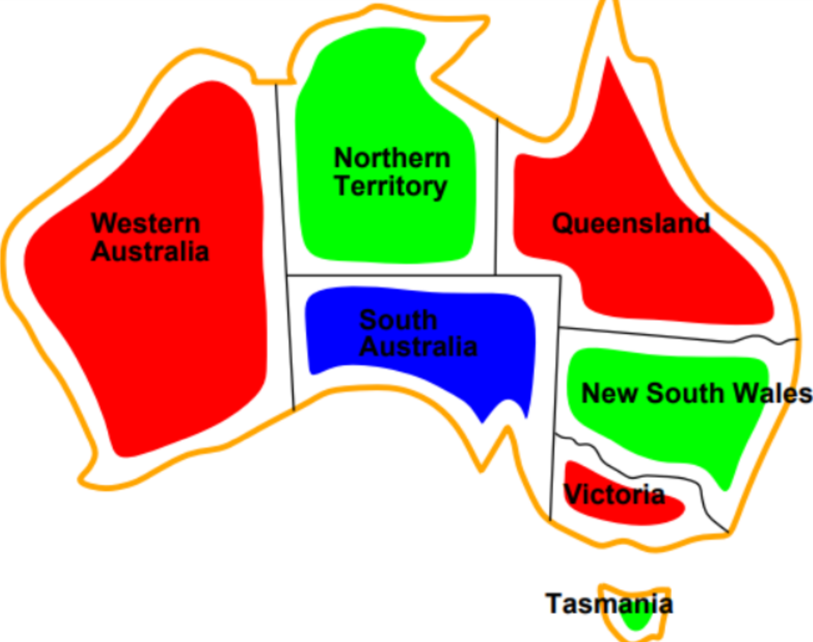

# Constraint Satisfaction

**Content:**
- CSP intro
- CSP problem representation
  - Variables, domains, and constraints
  - Constraint graph
  - Constraint types
- Techniques
  - Backtracking
  - Forward checking
  - Minimum remaining values
  - Least Restrictive value
  - Arc consistency
  - Min-conflicts
- Homework problem

## Idea
- A CSP asks us to choose a value for every variable without breaking any constraints.
- In a CSP, we usually care about the final assignment, not the order in which it was built.

### Examples
- Schedule a set of lectures by assigning each lecture a room and a time slot
- Assign workers to shifts
- Place $n$ non-attacking queens on a square board with a size $n$

### Example Map Coloring
Color the map without having two bordering parts which have the same color

## Main concepts

- Variable
  - Each variable can take a value
  - Example: One variable per a lecture
- Domains of a given variable
  - Allowed values for each variable
  - Example: Time and room for a lecture
- Constraint
  - Combinations between variable assignments that are permitted
  - Example: Lectures with the same tutor should not overlap
- Partial assignment only some variables have values
  - Very often we start with empty variables and one by one assign all the variables
- Solution: a complete assignment satisfying every constraint.
- State: An assignment of the variables

## Constraint types

### By the number of constraints

| Type | Example | Representation |
|:--|:--|:--|
| Unary | SA cannot be green | Remove green from SA's domain |
| Binary | WA and NT must differ | An edge between WA and NT |
| Higher-order | Three tasks must use three distinct workers | A constraint over several variables |

### Hard rules and soft preferences

- A **hard constraint** must hold: a teacher cannot teach two classes at once.
- A **soft constraint** expresses a preference: avoid early classes when possible.
- Soft constraints add penalties to minimize, turning feasibility into constrained optimization.

## Techniques

### Backtracking search

> Assign one variable, reject conflicting values, and undo a choice when it leads nowhere.

- Choose an unassigned variable and try values compatible with the current assignment.
- If no value works, return to the previous decision.
- Assignments commute: A then B gives the same result as B then A. Do not explore both orders unnecessarily.

### Minimum remaining values

> Choose the unassigned variable with the fewest currently legal values.

- **MRV** tackles the most restricted decision first, exposing failure sooner.
- Count values compatible with the current assignment, not just the original domain sizes.
- With SA = red and NT = green, WA has only blue available.

### Least constraining value

> Try the value that removes the fewest options from unassigned neighbors.

- **LCV** orders values; MRV chooses variables.
- Suppose A can take red or blue, while its neighbor B can take red or green. Choosing blue leaves both options for B; red removes one.
- Ordering adds work but may reduce backtracking. This version counts immediate eliminations, without full propagation.

### Forward checking

> After an assignment, remove incompatible values from its unassigned neighbors.

- Setting SA = red removes red from WA, NT, Q, NSW, and V.
- An empty domain means this branch cannot succeed; backtrack immediately.
- It filters from the newly assigned variable, without propagating every consequence between unassigned variables.
- For $k$ unassigned neighbors, filtering takes $O(kd)$ constraint checks. This readable implementation also copies all domains, taking $O(nd)$ time and memory per call.

### Arc consistency

> Every remaining value of X must have a supporting value in Y's domain.

For the directed arc $X\rightarrow Y$:

$$\forall x\in D_X,\quad \exists y\in D_Y:\ C_{XY}(x,y).$$

- If X must differ from Y and $D_Y=\{red\}$, remove red from $D_X$.
- Revise both directions: support for X's values and support for Y's values are separate checks.
- Unlike forward checking, arc consistency can propagate between variables that have not been assigned.

### Min-conflicts

> Start with a complete assignment and repair one conflicted variable at a time.

- Pick a variable involved in a violated constraint (not specified in what oder)
- Give it a value with the fewest conflicts. If more than 1 minimal value, pick one randomly
- Unlike backtracking, all variables already have values. (This is the main difference from the LCP)

## Homework

### N-queens as a CSP

> Place n queens so that no pair shares a row, column, or diagonal.

- **Variable** $Q_c$: the row of the queen in column $c$.
- **Domain**: rows $0,\ldots,n-1$ for every queen.
- One variable per column already prevents column conflicts, no need to preserve the column conflicts
- For distinct columns(queens), require that the no 2 queens have the same row or diagonal
- Positive board sizes have solutions except $n=2$ and $n=3$.

For four queens, `[1, 3, 0, 2]` means the queen in column 0 is in row 1, queen in column 1 is in row 3 and so one

### Counting attacks efficiently

> Have a counter for every row/descending diagonal/ascending diagonal

| Counter | Index for a queen at (row, col) | Array length |
|:--|:--|:--|
| Rows | $row$ | $n$ |
| Descending diagonals | $row-col+n-1$ | $2n-1$ |
| Ascending diagonals | $row+col$ | $2n-1$ |

- For a queen already on the board, the three counters include that queen three times. Subtract 3 to count its attackers.
- Before scoring replacement rows, temporarily remove that queen from the counters.
- Summing per-queen attacks counts each attacking pair twice.

### Min-conflicts with queen counters

> Move a conflicted queen to a row with the fewest attackers.

- Initialize one queen in each column, then build the three counter arrays.
- Select a conflicting queen at random and remove the chosen queen, score all rows, select a minimum at random, and update the counters.