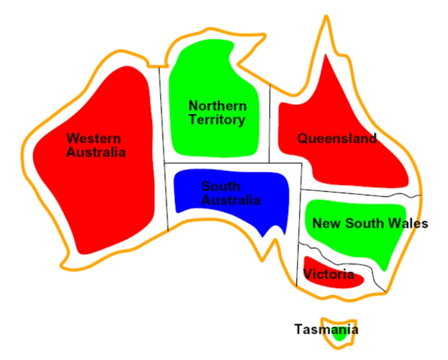
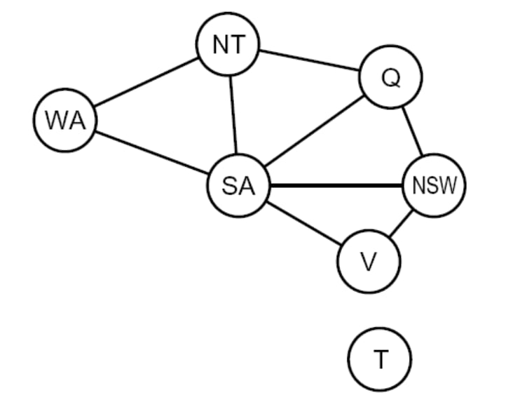
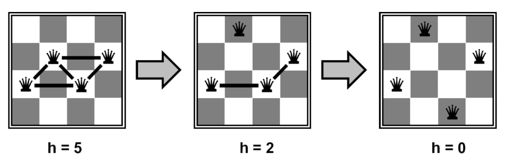

# Constraint Satisfaction Problem (CSP)

**Content:**
- CSP intro
- CSP problem representation
  - Variables, domains, and constraints
  - Constraint graph
  - Constraint types
- Techniques
  - Backtracking
  - Forward checking
  - Minimum remaining values
  - Least Restrictive value
  - Arc consistency
  - Min-conflicts
- Homework problem

## CSP intro

Unlike search problems, CSPs are a type of identification problem, problems in which we must **simply identify whether a state is a goal state or not**, with no regard to how we arrive at that goal.

### Real-world CSPs
Assignment problems, Timetabling problems, Transportation scheduling

## CSP problem representation

### Variables, domains, and constraints

CSPs are defined by three factors:

1. *Variables*  - CSPs possess a set of $N$ variables $X_1, ..., X_N$ that can each take on a single value from some defined set of values.
2.  *Domain* - A set $ {x_1,..., x_d} $ representing all possible values that a CSP variable can take on. 
3. *Constraints* - Constraints define restrictions on the values of variables, potentially with regard to other variables.

Shortly CSP:
* state is defined by variables $X_i$ with values from domain $D_i$
* goal test is a set of constraints specifying allowable combinations of values for subsets of variables

#### Example: Map coloring

Map coloring solves the problem where we’re given a set of colors and must color a map such that no two adjacent states or regions have the same color.

* Variable: ***WA, NT, Q, NSW, V, SA, T***
* Domains:  ***$D_i$ = {red, green, blue}***
* Constraints: adjacent regions must have different colors e.g., WA ≠ NT (if the language allows this), or (WA, NT) ∈ {(red, green),(red, blue),(green, red),(green, blue), . . .}
* ***Solutions*** are assignments satisfying all constraints, e.g., {WA = red, NT = green, Q = red, NSW = green, V = red, SA = blue, T = green}

### Constraint graph

Constraint satisfaction problems are often represented as constraint graphs, where nodes represent variables and edges represent constraints between them.

Example of the Constraint graph for the Map coloring problem.
The constraints in this problem are simply that no two adjacent states can be the same color. As a result, by drawing an edge between every pair of states that are adjacent to one another, we can generate the constraint graph for the map coloring of Australia as follows:

### Constraint types

There are many different types of constraints, and each is handled slightly differently:
* ***Unary Constraints*** - involve a single variable in the CSP. They are not represented in constraint graphs, instead simply being used to prune the domain of the variable they constrain when necessary. eg. $SA \neq green$
* ***Binary Constraints*** - Binary constraints involve two variables. They’re represented in constraint graphs as traditional graph edges. e.g. $ SA \neq WA$
* ***Higher-order Constraints*** - Constraints involving three or more variables can also be represented with edges in a CSP graph.

### University Course Timetabling CSP
The variables are the assignment of a time slot and a room to each class (e.g., specific lectures, tutorials, and labs).
   * $V = \{ C_1, C_2, ..., C_n \}$
   * The domain for each variable $C_i$ is a set of possible (Time Slot, Room) pairs, but other things should be take into account, which leads to a high-order constarints.

1. **Maximum Capacity Constraint (Order 1$)**: This constraint ensures that the room which hosts the lecture is with enough capacity (No simultaneous usage)
   * Room ($R$): The capacity is a property of the room.
   * Classes ($C_i, C_j, \dots$): The classes assigned to that room and time.
   
2. **Professor/Student Availability and Load Constraints (Order $\ge 3$)**:Constraints related to the workload or availability of a single resource (like a professor or a pool of shared equipment) across multiple classes. 
   * Professor ($P$): A shared resource.
   * Classes ($C_i, C_j, C_k, \dots$): The classes taught by that professor.
   * Time Slots ($T_i, T_j, T_k, \dots$): The scheduled times.
   * Constraint Example (Conceptual): A professor $P$ cannot teach more than 3 classes on any given day, or they must have a 1-hour break between consecutive classes.

3. **No simultaneous usage (Order 2)**: Ensures that no lectures happen in the same time ($T_i \ne T_j \& R_i \ne R_j$)

* ***Preferences (soft constraints)*** - e.g., red is better than green often representable by a cost for each variable assignment → constrained optimization problems

## Techniques

The most used techniques are variants of:
* Backtracking (Depth-First Search)
* Constraint Propagation
   * Forward checking
   * Arc consistency (ac3 algorithm) - for more watch this video [here](https://www.youtube.com/watch?v=4cCS8rrYT14)
* Local Search
   * minConflict (Hill Climbing)

### Backtracking

Constraint satisfaction problems are traditionally solved using **backtracking**. Backtracking is an optimization on depth-first search used specifically for the problem of constraint satisfaction, with improvements coming from two main principles:
1. **Fix an ordering for variables**, and select values for variables in this order. Because assignments are commutative (e.g. assigning $WA = Red, NT = Green$ is identical to $NT = Green, WA = Red$)
2. When selecting values for a variable, **only select values that don’t conflict with any previously assigned values**. If no such values exist, backtrack and return to the previous variable, changing its value.

### Forward checking
* ***Forward checking*** - After assigning a variable, remove incompatible values from the domains of its unassigned neighbors. If any domain becomes empty, backtrack.  

### Minimum remaining values

* ***Minimum Remaining Values (MRV)*** - When selecting which variable to assign next, using an MRV policy chooses whichever unassigned variable has the fewest valid remaining values (the most constrained variable). This is intuitive in the sense that the most constrained variable is most likely to run out of possible values and result in backtracking if left unassigned, and so it’s best to assign a value to it sooner than later.

### Least Restrictive value

* ***Least Constraining Value (LCV)*** - Similarly, when selecting which value to assign next, a good policy to implement is to select the value that prunes the fewest values from the domains of the remaining unassigned values. Notably, this requires additional computation (e.g. rerunning arc consistency/forward checking or other filtering methods for each value to find the LCV), but can still yield speed gains depending on usage.

### Arc consistency
A method for simplfying the domain of the variables, which makes it much simpler to be solved with a simple method like backtracking

* A directed arc $X \rightarrow Y$ is consistent if every value $x \in D_X$ has at least one compatible value $y \in D_Y$ satisfying their constraint:
$$
\forall x \in D_X,\quad \exists y \in D_Y:\ C_{XY}(x,y).
$$
* For each constraint between every 2 variables ($X$ or $Y$) create 2 arcs, $A_(XY)$ and $A_(YX)$
* Start iterating the arcs, remove all the values from the Domain of the variable on the left hand side which make the arc not consistent
* Add to the arcs for iteration all of the arcs where the left hand side value is on the right side
* Arc consistency (ac3 algorithm) - for more watch this video [here](https://www.youtube.com/watch?v=4cCS8rrYT14)

### Min-conflicts
Start with some random assignment to values, then **iteratively select a random conflicted variable and reassign its value to the one that violates the fewest constraints until no more constraint violations exist** (a policy known as the min-conflicts heuristic).
Under such a policy, constraint satisfaction problems like N-queens become both very time-efficient and space-efficient to solve.

The eight queens puzzle is the problem of placing eight chess queens on
an 8×8 chessboard so that no two queens threaten each other; thus, a
solution requires that no two queens share the same row, column, or
diagonal. The eight queens puzzle is an example of the more general n
queens problem of placing n non-attacking queens on an n×n chessboard,
for which solutions exist for all natural numbers n with the exception of n
= 2 and n = 3.

For example, in the following example with 4 queens, we arrive at a solution after only 2 iterations:

$h(n)$ = number of attacks

## Homework problem

### Solving the N-queens Problem

n = the size of the board

Each queen should be in different column. We will represent the queens by the column they are in. $Queen_0$ in $column_0$, $Queen_1$ in $column_1$ ... $Queen_N$ in $column_N$. 

To track the conflict and in which row $Queen_i$ is positioned we will use the following arrays:
 * $queenPosition$ - keeps track in which row is $Queen_i$
 * $conflictRows$ - number of queens in each row
 * $conflictPositiveDiagonals$ - number of queens in each positive diagonal
 * $conflictNegativeDiagonals$ - number of queens in each negative diagonal

The number of positive/negative diagnals in $nxn$ matrix is $2*n-1$
* Accessing the $ith$ positive diagonal: $(row + col)$
* Accessing the $ith$ negative diagonal: $(n - 1 -row + col)$

$h(n)$ = total number of conflicts on the board

1. Initialize the starting positions of the queens randomly 
2. Until the number of consflicts is zero 
    * take a random conflicted queen and remove her from the current row
    * calculate the number of conflicts by positing the queen at $row_i$ for all $i = 0, ..., n-1$
    * for all rows that the count of the conflicts is minimal, choose a random one to place the queen
