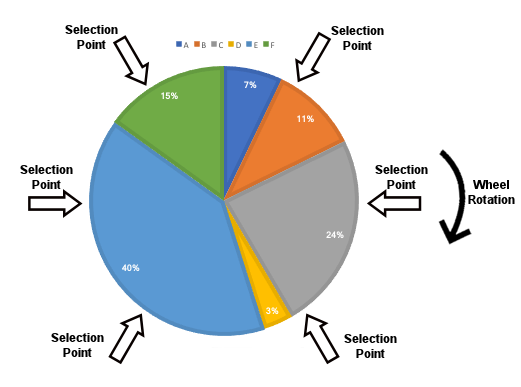

# Genetic Algorithms

**The central question:** Can a population of imperfect answers produce better answers over several generations?

**Content:**
- Chromosomes, representations, and fitness
- Parent selection and selection pressure
- Crossover, mutation, and elitism
- A complete genetic algorithm
- Travelling salesman and N-queens examples
- Knapsack homework

Run the cells from top to bottom using Python 3. The examples use only the standard library and fixed random seeds.

```python
import random
from math import ceil, dist
```

## Concepts
> Goal: Maintain several candidate solutions, then use them to generate a new population.

- **gene**: one component of a solution.
- **chromosome / individual**: one complete solution.
- **population**: set of solutions which is in one iteration.
- **generation**: one iteration of replacing the current population with a new population.
- **fitness score**: evaluation of a given solution

## Example
### Problem

Minimize the **Rosenbrock function** for $n\geq 2$:

$$
\min_{\mathbf{x}\in[-3,3]^n} f(\mathbf{x})
=\sum_{j=1}^{n-1}\left[100(x_{j+1}-x_j^2)^2+(1-x_j)^2\right].
$$

Neighboring variables interact, making the narrow, curved valley toward the optimum $\mathbf{x}^*=[1,\ldots,1]$ difficult to navigate.

### Solution → gene → population

- **Chromosome / individual:** one complete candidate solution, $\mathbf{x}=[x_1,\ldots,x_n]$, e.g. $[0.3,1.8,...,-0.2]$.
- **Gene:** one number $x_j$ in that solution, e.g. the second gene is $1.8$.
- **Population:** $m$ candidate solutions, $P=[\mathbf{x}^{(1)},\ldots,\mathbf{x}^{(m)}]$, each containing $n$ genes.
- **Fitness score**: could be the value of the function given a particular chormosome. The closer to the 0, the better is the chromosome.

## The generation cycle

```text
Initialize → Evaluate → Selection → Crossover → Mutate → New Population → Conversion Check → Final solution
                ↑                                                                │
                └────────────────────────────────────────────────────────────────┘
```

- Initialization: Create a starting population
- Evaluate: Compute the fitness scores of the population chromosomes
- Selection: Select which chromosomes to continue the population
- Crossover: Combine the selected solutions in order to produce new
- Mutation: Mutate the surviving solutions in order to increase the diversity
- Conversion Check: Check if the population continues improving or has potential to improve
  - If it has not converged, start a new iteration
  - If it has converged, we've reached the final solution

## Selection

### Selection pressure

> Control how strongly parent selection favors better individuals.

- Strong pressure spreads good traits quickly, but may remove useful diversity too early.
- Weak pressure gives weaker individuals more opportunities, but may lead to slow improvement.
- Selecting a parent does not guarantee that its child is better.

```python
population = ['A', 'B', 'C', 'D', 'E']
scores = [10, 20, 30, 25, 15]
```  


### Roulette-wheel selection

> Give each individual a share of the selection probability proportional to its fitness.

$$P(i)=\frac{f_i}{\sum_j f_j}$$

- Sampling uses replacement: a parent may be chosen more than once.
- Large score differences can make one individual dominate.
- Usable for nonnegative fitness scores  

```python
def roulette_select(population, scores, rng, count=1):
    return rng.choices(population, weights=scores, k=count)  
```


### Tournament selection

> Sample k indviduals on random from the population. From them select the best candidate.  

- $k$ contolls the selection pressure.
  - Higher $k$ leads to a higher selection pressure
  - $k=1$ makes the choice of the candidate random

```python
def tournament_select(population, scores, rng, count=1, size=3):
    selected = []
    for _ in range(count):
        candidates = rng.sample(range(len(population)), size)
        winner = max(candidates, key=lambda i: scores[i])
        selected.append(population[winner])
    return selected

print('Tournament:', tournament_select(population, scores, random.Random(7), count=5))
```


### Rank-based selection

> Sort the individuals by fitness. Give better-ranked individuals a higher probability of being selected.

- Selection depends on rank, so large score differences do not make one individual dominate.
- Equal scores receive the same rank in this implementation.
- Sampling uses replacement: a parent may be chosen more than once.

```python
def rank_select(population, scores, rng, count=1):
    ranks = {score: rank for rank, score in enumerate(sorted(set(scores)), start=1)}
    weights = [ranks[score] for score in scores]
    return rng.choices(population, weights=weights, k=count)
```

### Stochastic universal sampling



> Give each individual a segment proportional to its fitness, as in roulette-wheel selection. Select parents using equally spaced pointers with one random starting point.

- The distance between pointers is total fitness divided by the number of parents to select.
- Selects parents more evenly according to their fitness than independent roulette-wheel draws.
- A parent may be chosen more than once.
- Usable for nonnegative fitness scores. All-zero scores receive equal weights below.

```python
def sus_select(population, scores, rng, count=1):
    weights = list(scores)
    spacing = sum(weights) / count
    start = rng.random() * spacing
    selected, index, cumulative = [], 0, weights[0]

    for i in range(count):
        pointer = start + i * spacing
        while index < len(population) - 1 and pointer >= cumulative:
            index += 1
            cumulative += weights[index]
        selected.append(population[index])
    return selected
```

### Elitism

> Copy a small number of the best current individuals directly into the next generation.

- Elites survive unchanged; they do not go through crossover or mutation.
- Keeping the best individual preserves the best score when the fitness function stays the same.
- The number of elites controls how much of the population is preserved.
  - More elites preserve more existing solutions but leave less room for new candidates.
  - Too many elites can reduce diversity and slow improvement.

```python
def keep_elites(population, scores, count=1):
    order = sorted(range(len(population)), key=lambda i: scores[i], reverse=True)
    return [population[i].copy() for i in order[:count]]
```

### Truncation selection

> Sort the individuals by fitness. Keep only the top fraction, then select parents randomly from that group.

- The retained fraction controls the selection pressure.
  - A smaller fraction leads to higher selection pressure and can reduce diversity.
  - A fraction of 1 makes parent selection random across the whole population.
- All retained individuals have the same probability of being selected.
- Sampling uses replacement: a parent may be chosen more than once.
- The opposite of the tournament selection

```python
def truncation_select(population, scores, rng, count=1, fraction=0.4):
    order = sorted(range(len(population)), key=lambda i: scores[i], reverse=True)
    retained = [population[i] for i in order[:ceil(fraction * len(population))]]
    return rng.choices(retained, k=count)
```

### Compare selection policies

| Policy | What controls selection? | Main tradeoff |
|:--|:--|:--|
| Roulette | Relative fitness weights | Sensitive to score differences |
| Tournament | Best of $k$ sampled individuals | Tournament size controls pressure |
| Rank-based | Ordered fitness levels | Ignores the size of fitness gaps |
| SUS | Equally spaced weighted pointers | Lower sampling variance |
| Elitism | Best individuals survive unchanged | Protects progress but reduces turnover |
| Truncation | Membership in the top fraction | Strong pressure can remove diversity |

## One-point crossover

> Copy a prefix from one parent and the suffix from the other.

```text
Parent A: 1 1 1 | 0 0 0
Parent B: 0 0 0 | 1 1 1
Child:    1 1 1 | 1 1 1
```

- Suitable for fixed-length sequences when mixing positions preserves validity, such as bit strings.
- The cut lies between genes. Both parents must have the same length, at least 2.
- Time and output storage are $O(L)$ for chromosome length $L$.

```python
def one_point(a, b, rng):
    cut = rng.randrange(1, len(a))
    return a[:cut] + b[cut:]

parent_a = [1, 1, 1, 0, 0, 0]
parent_b = [0, 0, 0, 1, 1, 1]
print('One-point child:', one_point(parent_a, parent_b, random.Random(7)))
```

```text
One-point child: [1, 1, 1, 1, 1, 1]
```

## Uniform crossover

> At each position, independently choose a gene from either parent.

- Both parents contribute without needing one shared cut point.
- Mixing can disrupt groups of genes that work well together.
- Like one-point crossover, it does not automatically preserve a permutation. Time and output storage are $O(L)$.

```python
def uniform_crossover(a, b, rng):
    return [x if rng.random() < 0.5 else y for x, y in zip(a, b)]

print('Uniform child:', uniform_crossover(parent_a, parent_b, random.Random(7)))
```

```text
Uniform child: [1, 1, 0, 0, 1, 0]
```

## Permutations need different operators

```text
Parent A: A B | C D E
Parent B: D E | A B C
Naive child: A B A B C
```

- Ordinary one-point crossover duplicated A and B and lost D and E.
- A valid tour must still contain each city once. Use permutation-preserving crossover or explicitly repair the child.
- Filtering repeated genes is an extra rule; it is not ordinary one-point crossover.

## Order crossover

> Keep a segment from one parent, then fill the remaining positions in the other parent's order.

- Copy the chosen segment at its original positions.
- Read the second parent cyclically from the segment's end, skipping genes already copied.
- Fill the empty positions in the same cyclic order.
- Parents must be permutations of the same unique, hashable genes. With a set for membership checks, time and extra space are $O(L)$.

```python
def order_crossover(a, b, rng):
    start, stop = sorted(rng.sample(range(len(a) + 1), 2))
    child = [None] * len(a)
    child[start:stop] = a[start:stop]
    used = set(a[start:stop])
    remaining = [gene for gene in b[stop:] + b[:stop] if gene not in used]
    empty = list(range(stop, len(a))) + list(range(start))
    for position, gene in zip(empty, remaining):
        child[position] = gene
    return child

print('Order child:', order_crossover(list('ABCDE'), list('DEABC'), random.Random(7)))
```

```text
Order child: ['E', 'B', 'A', 'C', 'D']
```

## Other crossover choices

| Representation | Related operators | What changes? |
|:--|:--|:--|
| Bit strings / ordinary sequences | Two-point, multi-point | Alternate copied segments |
| Real-valued vectors | Arithmetic crossover | Blend values, e.g. $child_i=\alpha a_i+(1-\alpha)b_i$ |
| Permutations | Partially mapped (PMX), cycle crossover | Preserve unique genes through mapping or cycles |

Choose operators for the encoding. Blending city labels or flipping a permutation gene as if it were a bit has no useful meaning.

## Bit-flip mutation

> Independently flip each bit with a small probability.

- Mutation can introduce alleles absent from the selected parents.
- With per-gene rate $p$ and length $L$, the expected number of flips is $Lp$, not exactly one flip.
- Too little mutation can leave the population stagnant; too much can destroy useful structure.
- This version takes $O(L)$ time and returns a new list, leaving its input unchanged.

```python
def bit_mutation(chromosome, rng, rate=0.05):
    return [1 - bit if rng.random() < rate else bit for bit in chromosome]

print('Mutated bits:', bit_mutation(parent_a, random.Random(7), rate=0.3))
```

```text
Mutated bits: [1, 0, 1, 1, 0, 0]
```

## Swap mutation

> Exchange two positions without adding or losing genes.

- Appropriate for tours and other permutations.
- Here `rate` is the probability of one swap **per individual**, unlike the per-gene bit-flip rate.
- The swap is constant time; copying the chromosome makes this implementation $O(L)$ in time and output storage.

```python
def swap_mutation(chromosome, rng, rate=0.2):
    child = chromosome.copy()
    if len(child) >= 2 and rng.random() < rate:
        i, j = rng.sample(range(len(child)), 2)
        child[i], child[j] = child[j], child[i]
    return child

print('Swapped tour:', swap_mutation(list('ABCDE'), random.Random(7), rate=1.0))
```

```text
Swapped tour: ['A', 'D', 'C', 'B', 'E']
```

## A complete genetic algorithm

> Evaluate the population, preserve elites, and fill the remaining places with offspring.

- `make_individual(rng)` creates a chromosome; `fitness(chromosome)` returns a score to maximize.
- `crossover(a, b, rng)` and `mutate(child, rng)` must preserve the chosen encoding and leave parents unchanged.
- Tournament selection uses cached scores. The population size stays fixed.
- Return the **best individual encountered** and a history of each generation's best score, including generation 0.
- An optional `target` stops at a known score. A generation limit alone gives no completeness or global-optimum guarantee.

```python
def genetic_algorithm(make_individual, fitness, crossover, mutate,
                      pop_size=40, generations=80, elite_count=1,
                      seed=7, target=None):
    if pop_size < 2 or generations < 0 or not 0 <= elite_count < pop_size:
        raise ValueError('Use population >= 2, generations >= 0, and 0 <= elites < population')
    rng = random.Random(seed)
    population = [make_individual(rng) for _ in range(pop_size)]
    best, best_score, history = None, float('-inf'), []

    for generation in range(generations + 1):
        scores = [fitness(individual) for individual in population]
        winner = max(range(pop_size), key=lambda i: scores[i])
        if scores[winner] > best_score:
            best, best_score = population[winner].copy(), scores[winner]
        history.append(scores[winner])
        if generation == generations or (target is not None and best_score >= target):
            break

        next_population = keep_elites(population, scores, elite_count)
        while len(next_population) < pop_size:
            a, b = tournament_select(population, scores, rng, count=2,
                                     size=min(3, pop_size))
            child = crossover(a, b, rng)
            next_population.append(mutate(child, rng))
        population = next_population

    return best, history

best_bits, bit_history = genetic_algorithm(
    lambda rng: [rng.randrange(2) for _ in range(8)],
    ones_fitness, one_point, bit_mutation, target=8)
print('Best bits:', best_bits, '| fitness:', ones_fitness(best_bits))
print('Generation best scores:', bit_history)
```

```text
Best bits: [1, 1, 1, 1, 1, 1, 1, 1] | fitness: 8
Generation best scores: [6, 7, 8]
```

## Cost and guarantees

Let $P$ be population size, $L$ chromosome length, $G$ the generation budget, and $F$ the cost of evaluating one individual.

- **Time complexity**: $O(PL+(G+1)(PF+P\log P+PL))$ for the loop above: initialization, evaluation, elite sorting, and linear-time variation with fixed-size tournaments.
- **Space complexity**: $O(PL+G)$ for the current/next populations and recorded history, excluding problem data and fitness-function workspace.
- **Complete / Optimal**: no guarantee in a finite stochastic run. Fitness evaluation can dominate the total cost.
- Increasing the generation budget gives more attempts; it does not certify that the best result is globally optimal.

## Diversity and stopping

- **Premature convergence**: many individuals become alike before a sufficiently good result is found.
- Track best fitness and the number of distinct chromosomes; a flat best score alone does not explain why progress stopped.
- Adjust mutation, tournament size, population size, or restart policy when exploring alternatives.
- Elitism preserves the best score under fixed fitness, but the average score can still fall.
- Compare several seeds with the same evaluation budget. One successful run is not a reliability estimate.

## Travelling salesman problem

> Visit every city once and return to the starting city with minimum total distance.

- **Chromosome**: a permutation of city labels.
- **Objective**: sum consecutive distances, including the closing edge to the first city.
- **Fitness**: $1/(1+distance)$; shorter tours receive larger positive scores.
- Order crossover and swap mutation preserve valid tours. The starting city can change without changing the underlying cycle.

```python
cities = {'A': (0, 0), 'B': (2, 0), 'C': (3, 2), 'D': (1, 4), 'E': (-1, 2)}

def tour_length(tour, coordinates):
    closed_tour = tour[1:] + tour[:1]
    return sum(dist(coordinates[a], coordinates[b])
               for a, b in zip(tour, closed_tour))

def tour_fitness(tour):
    return 1 / (1 + tour_length(tour, cities))

best_tour, tour_history = genetic_algorithm(
    lambda rng: rng.sample(list(cities), len(cities)),
    tour_fitness, order_crossover, swap_mutation,
    pop_size=30, generations=60)
print('Tour:', ' → '.join(best_tour + best_tour[:1]))
print('Distance:', round(tour_length(best_tour, cities), 3))
```

```text
Tour: B → A → E → D → C → B
Distance: 12.129
```

## N-queens with a population

> Evolve queen placements instead of repairing just one board as in min-conflicts.

- Gene $c$ stores the queen's row in column $c$.
- Initialize a permutation of rows: each row and column already contains exactly one queen.
- **Fitness**: $n(n-1)/2$ minus the number of attacking pairs. The maximum means no attacks.
- Use order crossover and swap mutation to retain row uniqueness.
- This transparent fitness function checks pairs in $O(n^2)$. Row/diagonal counters from the CSP lecture can reduce evaluation work.

```python
def queen_fitness(board):
    n = len(board)
    attacks = sum(board[i] == board[j] or abs(board[i] - board[j]) == j - i
                  for i in range(n) for j in range(i + 1, n))
    return n * (n - 1) // 2 - attacks

n = 8
target = n * (n - 1) // 2
best_queens, queen_history = genetic_algorithm(
    lambda rng: rng.sample(range(n), n),
    queen_fitness, order_crossover, swap_mutation,
    pop_size=80, generations=150, target=target)
print('Queen rows by column:', best_queens)
print('Attacking pairs:', target - queen_fitness(best_queens))
print('Generations completed:', len(queen_history) - 1)
for row in range(n):
    print(' '.join('Q' if queen_row == row else '.' for queen_row in best_queens))
```

```text
Queen rows by column: [6, 3, 1, 7, 5, 0, 2, 4]
Attacking pairs: 0
Generations completed: 3
. . . . . Q . .
. . Q . . . . .
. . . . . . Q .
. Q . . . . . .
. . . . . . . Q
. . . . Q . . .
Q . . . . . . .
. . . Q . . . .
```

## Knapsack problem

> Choose valuable items without exceeding the available weight capacity.

- **Chromosome**: one bit per item; 1 includes the item, 0 excludes it.
- **Hard constraint**: total weight must not exceed capacity.
- Below, an overweight chromosome receives fitness 0; a feasible chromosome receives its total value.
- A penalty can leave many invalid individuals tied at zero. Alternatives include repairing overweight chromosomes or prioritizing feasibility explicitly.
- Crossover and bit mutation preserve the encoding, but not necessarily the capacity constraint.

```python
items = [('Water', 3, 9), ('Food', 4, 12), ('Jacket', 5, 13),
         ('Camera', 2, 6), ('Book', 2, 4)]  # name, weight, value
capacity = 9

def knapsack_totals(chromosome, items):
    weight = sum(bit * item[1] for bit, item in zip(chromosome, items))
    value = sum(bit * item[2] for bit, item in zip(chromosome, items))
    return weight, value

def knapsack_fitness(chromosome):
    weight, value = knapsack_totals(chromosome, items)
    return value if weight <= capacity else 0

for choice in [[1, 0, 0, 1, 1], [1, 1, 1, 0, 0]]:
    print(choice, '| weight/value:', knapsack_totals(choice, items),
          '| fitness:', knapsack_fitness(choice))
```

```text
[1, 0, 0, 1, 1] | weight/value: (7, 19) | fitness: 19
[1, 1, 1, 0, 0] | weight/value: (12, 34) | fitness: 0
```

## Homework problem

> Use a genetic algorithm to pack the knapsack, then check how reliable its answer is.

- **Initial population**: random bit lists with one position per item above.
- **Variation**: one-point or uniform crossover, followed by bit-flip mutation.
- **Objective**: maximize item value while keeping weight at most 9.
- **Output**: selected item names, total weight, total value, and generation history. If the best returned chromosome is overweight, report that no feasible result was found in that run.
- **Stopping rule**: a fixed generation/evaluation budget; do not assume the first feasible packing is optimal.

## Homework tasks

- Connect the knapsack fitness and suitable operators to the genetic algorithm above.
- Compare at least five seeds with the same population and generation budget; report valid results and failures.
- Change tournament size, mutation rate, or elite count one at a time. Explain the effect on diversity and best fitness.
- Enumerate all $2^5$ choices to find the true optimum of this small instance. Measure how often your GA reaches it.
- Optional: replace the zero penalty with a repair step and compare feasible-offspring rates. Explain how the repair rule affects which solutions are explored.
